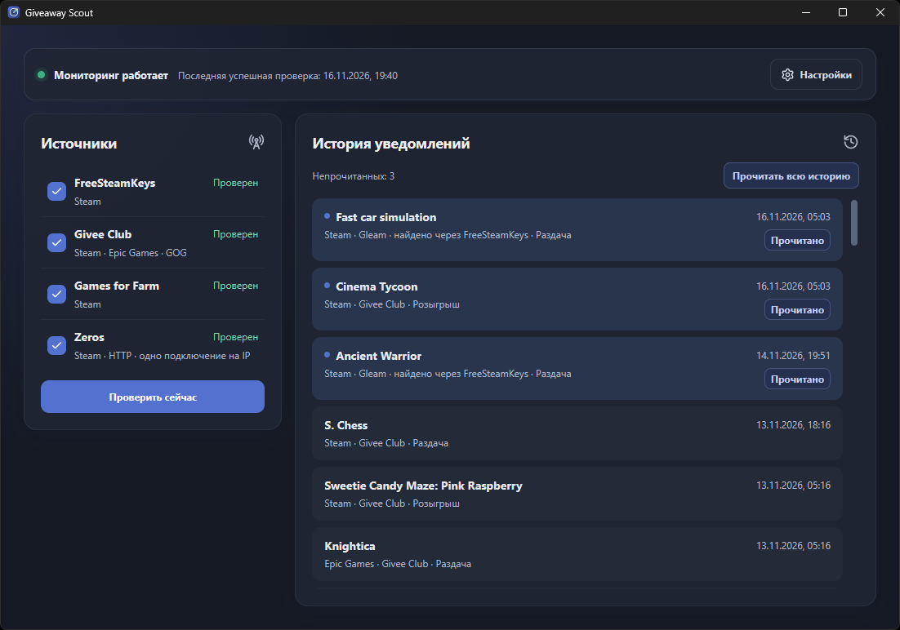

# Giveaway Scout

Приложение для отслеживания раздач игр и розыгрышей для Steam, Epic Games и GOG на FreeSteamKeys, Givee Club, Games for Farm и Zeros. Работает в графическом окне с системными уведомлениями или в консоли. Оба режима используют общее ядро, настройки и историю.

[Скачать для Windows](https://github.com/gogolevmatvey/giveaway-scout/releases/latest)



## Возможности

- Уведомления о новых раздачах игр и розыгрышах с переходом на страницу раздачи.
- История раздач.
- Выбор источников.
- Выбор уведомлений для Steam, Epic Games и GOG.
- Консольные команды для мониторинга, чтения истории, настройки и обновления приложения.
- Русский и английский интерфейс.
- Трей, автозапуск и запуск свёрнутым.

## Установка в Windows

Основная сборка — Windows x64. Скачайте установщик `*-setup.exe` из [последнего релиза](https://github.com/gogolevmatvey/giveaway-scout/releases/latest). Установщик позволяет выбрать графическое приложение, консольную версию или оба компонента; по умолчанию выбрано графическое приложение. Для установки только CLI WebView2 не требуется.

Папка по умолчанию — `%LOCALAPPDATA%\Giveaway Scout`. Повторная установка использует ранее выбранный путь. Настройки и история сохраняются при обновлении и изменении набора компонентов.

В релизе публикуются установщик, его подпись `.sig`, описание обновления `latest.json` и контрольные суммы `SHA256SUMS.txt`.

## Статистика использования

Приложение автоматически отправляет статистику использования, чтобы оценивать количество активных пользователей. Передаются только случайный идентификатор установки и версия приложения.

## Разработка в Windows

Требуются Windows-версии Node.js 24.21.0, pnpm 12.10.1, Rust 1.100.0, Visual Studio Build Tools с C++/Windows SDK и Microsoft Edge WebView2 Runtime. Версия компилятора закреплена в `rust-toolchain.toml`; минимально поддерживаемая версия Rust в Cargo-манифестах остаётся 1.99.1.

Из корня проекта:

```powershell
cd src\GiveawayScout.Desktop
pnpm install --frozen-lockfile
pnpm tauri dev
```

Интерфейс обновляется при сохранении файлов; Rust-часть пересобирается автоматически. Dev- и Release-профили данных разделены.

## Проверки и сборка

Из каталога `src/GiveawayScout.Desktop`:

```powershell
pnpm test
pnpm build
pnpm test:ui:browser
pnpm test:ui:native
```

Нативные UI-тесты используют отдельный профиль и контролируемые данные. Они не заменяют ручную проверку настоящих системных уведомлений, автозапуска и установки обновлений.

Проверки Rust-ядра и инструментов выпуска:

```powershell
cd src-tauri
cargo test --workspace --locked
cargo clippy --workspace --all-targets --locked -- -D warnings
```

Внутренняя Windows x64-сборка из корня проекта:

```powershell
.\scripts\build-windows.ps1 -BuildLabel next
```

EXE графического и консольного приложений и NSIS-установщик появятся в `src/GiveawayScout.Desktop/src-tauri/target-windows-x64-next/release/`. Обычная внутренняя сборка не подключает канал обновлений.

CLI также можно собрать отдельно из исходников без frontend и Tauri:

```powershell
cd src\GiveawayScout.Desktop\src-tauri
cargo build -p giveaway-scout-cli --release --locked
```

## Лицензия

[MIT](LICENSE).
